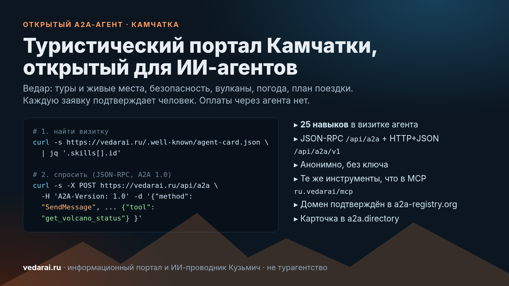

# Как мы открыли туристический портал Камчатки для ИИ-агентов по A2A



Человек всё чаще спрашивает про поездку не поисковик, а своего ИИ-ассистента. Ассистент, в свою очередь, всё чаще спрашивает других агентов. Мы сделали так, чтобы на вопросы про Камчатку ему мог ответить [Ведар](https://vedarai.ru): туры местных операторов с живыми местами, безопасность маршрутов, вулканы, погода, план поездки по дням.

Ведар — информационный портал о путешествиях по Камчатке и ИИ-проводник Кузьмич. Мы не турагентство и не туроператор. Агент Ведара ничего не бронирует и не принимает оплату. Если человек хочет поехать, агент передаёт заявку, а подтверждает её живой человек: оператор тура, владелец жилья или перевозчик.

## Что такое A2A и зачем он порталу

[A2A (Agent2Agent)](https://a2a-protocol.org/latest/) — открытый протокол, по которому ИИ-агенты находят друг друга и обмениваются задачами. Его начинал Google, сейчас он развивается в Linux Foundation. Если коротко: MCP связывает агента с инструментами, A2A связывает агента с другим агентом.

Чтобы агента можно было найти, он публикует визитку (Agent Card) по адресу `/.well-known/agent-card.json`. В ней описано, кто он, какие у него навыки, куда слать запросы и нужна ли авторизация. По спецификации это основной способ обнаружения публичных агентов. Единого официального реестра A2A при этом нет: есть визитка на своём домене и сторонние каталоги.

## Визитка Ведара

```bash
curl -s https://vedarai.ru/.well-known/agent-card.json | jq '{name, version, skills: [.skills[].id]}'
```

Что в ней сейчас (проверено 9 ноября 2026):

- протокол A2A 1.0; для клиентов старой версии 0.3 есть визитка по адресу [/.well-known/agent.json](https://vedarai.ru/.well-known/agent.json);
- два транспорта: JSON-RPC `https://vedarai.ru/api/a2a` и HTTP+JSON `https://vedarai.ru/api/a2a/v1`;
- анонимный доступ, без ключа и регистрации; ограничения только по частоте запросов с адреса;
- 25 навыков: свободный вопрос Кузьмичу (`kuzmich-chat`) и 24 инструмента — те же, что у нашего [MCP-сервера](https://vedarai.ru/mcp).

Навыки на чтение:

| Задача | Инструменты |
|---|---|
| Туры и места | `get_tours`, `get_tour_details`, `get_tour_availability`, `compare_tours` |
| Безопасность | `get_guardian_context`, `safety_status`, `get_volcano_status` |
| Места и погода | `get_place_info`, `get_weather` |
| Жильё и транспорт | `search_accommodations`, `search_transfers`, `search_car_rental`, `search_gear` |
| План поездки | `make_trip_plan`, `edit_trip_plan` |
| Коннекторы и статус | `search`, `fetch`, `get_request_status` |

`make_trip_plan` и `edit_trip_plan` сохраняют только анонимный черновик плана на 7 дней: без имени и телефона, до человека он не доходит.

## Как спросить агента

Агент понимает свободный текст по-русски и по-английски. Отвечает Кузьмич с теми же данными, что видит на сайте. Если нужен точный вызов, в сообщение кладут `DataPart` вида `{"tool": "<имя>", "arguments": {...}}`, схемы аргументов берутся из `tools/list` на `/api/mcp`.

Пример только на чтение — текущая вулканическая активность:

```bash
curl -s -X POST https://vedarai.ru/api/a2a \
  -H 'Content-Type: application/json' \
  -H 'A2A-Version: 1.0' \
  -d '{"jsonrpc":"2.0","id":1,"method":"SendMessage",
       "params":{"message":{"role":"ROLE_USER","messageId":"demo-1",
         "parts":[{"data":{"tool":"get_volcano_status","arguments":{}}}]}}}'
```

Задача завершается прямо в ответе: `TASK_STATE_COMPLETED`, в тексте — коды KVERT и сводка КФ ЕГС РАН по каждому вулкану с повышенной активностью и датами наблюдений. Стриминга и push-уведомлений задач нет, ответ приходит сразу и хранится час.

Так же можно запросить погоду (`get_weather` с `{"place": "Петропавловск-Камчатский"}`) или обстановку по краю (`safety_status`).

## Заявки: шесть видов, и каждую подтверждает человек

Пишущих навыков шесть:

- `create_lead` — подбор тура, когда тур и дата ещё не выбраны;
- `create_booking_request` — заявка оператору на конкретный тур и дату, сначала проверяются живые места;
- `create_stay_request` — заявка владельцу жилья на даты;
- `request_charter` — машина целиком: вахтовка, микроавтобус;
- `create_car_rental_request` — прокат машины без водителя, в два шага с кодом подтверждения;
- `create_trip_request` — поездка целиком: тур, жильё и транспорт под одним номером, каждый партнёр видит остальные части.

Правила общие для всех:

1. Нужен `consent: true` — согласие человека на передачу имени и телефона. Без него агент откажет. Агент не должен ставить согласие сам за человека.
2. Заявка — это не бронь. Её подтверждает человек на стороне оператора.
3. Оплаты через Ведар нет.
4. Состояние заявки можно узнать через `get_request_status`, без персональных данных. Для заявок (кроме жилья) можно передать `notify_url` и получать подписанный POST по Standard Webhooks, когда заявка меняется.

Мы сознательно не даём агентам «мгновенную бронь». На Камчатке погода и вулканы меняют планы, и решение должен принимать человек, который знает маршрут.

## Где Ведар можно найти, кроме визитки

- [Global A2A Registry (a2a-registry.org)](https://www.a2a-registry.org/agent/ru.vedarai.___vedar_kamchatka): домен vedarai.ru подтверждён через DNS, карточка закреплена за Ведаром.
- [a2a.directory](https://a2a.directory/agents/vedar-kamchatka-travel-ai-guide): карточка Vedar Kamchatka опубликована.
- MCP: сервер `https://vedarai.ru/api/mcp` записан в официальный MCP Registry как `ru.vedarai/mcp`.

Подключить к Claude Code одной командой:

```bash
claude mcp add --transport http vedar https://vedarai.ru/api/mcp
```

## Что мы поняли по ходу

- Визитка — главное. Каталоги переписывают её поля к себе, поэтому описание и навыки надо писать так, чтобы они были честными без контекста: что агент делает и чего не делает.
- Описание навыка — это подсказка для чужой модели. Мы пишем в каждом «когда использовать» и «что взять вместо», например: «для живых мест — `get_tour_availability`».
- Отказы тоже ответ. Если места нет в справочнике, агент так и говорит и не подставляет погоду соседнего места.
- Человек в цепочке — не слабость, а условие. Для дальних маршрутов, рыбалки и вертолётных туров это то, чего ждут и путешественники, и операторы.

## Попробовать

- Сайт: [vedarai.ru](https://vedarai.ru)
- Документация для агентов: [vedarai.ru/mcp](https://vedarai.ru/mcp)
- Визитка A2A: [vedarai.ru/.well-known/agent-card.json](https://vedarai.ru/.well-known/agent-card.json)
- Карточки в каталогах: [a2a-registry.org](https://www.a2a-registry.org/agent/ru.vedarai.___vedar_kamchatka) · [a2a.directory](https://a2a.directory/agents/vedar-kamchatka-travel-ai-guide)

Если вы делаете туристического или персонального ИИ-ассистента, подключите Ведар и спросите про Камчатку. Будем рады обратной связи.
