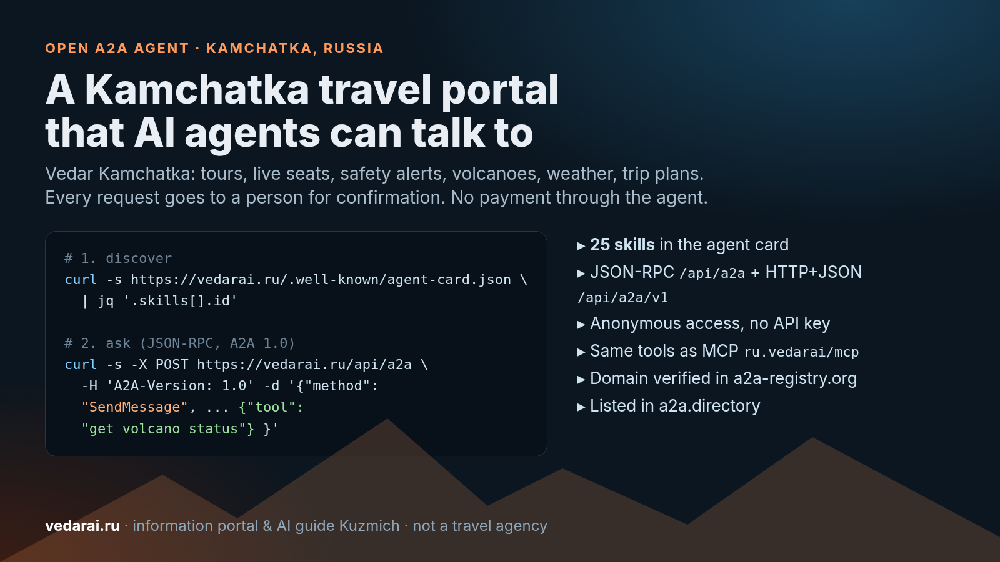

# We opened a Kamchatka travel portal to AI agents over A2A



People increasingly ask an AI assistant about a trip instead of a search engine, and assistants increasingly ask other agents. We wanted questions about Kamchatka (Russia's volcanic peninsula) to have a reliable answer, so we exposed [Vedar Kamchatka](https://vedarai.ru) as an open A2A agent: live tours from local operators with free seats, route safety, volcano status, weather and day-by-day trip plans.

First, what Vedar is and isn't: it's a travel **information portal** with an AI guide called Kuzmich. It is not a travel agency or tour operator. The agent doesn't book anything and doesn't take payments. When someone wants to go, the agent passes on a request, and a person confirms it: the tour operator, the lodging owner or the carrier.

## A2A in one paragraph

[A2A (Agent2Agent)](https://a2a-protocol.org/latest/) is an open protocol, started by Google and now hosted by the Linux Foundation, that lets agents discover each other and exchange tasks. MCP connects an agent to tools; A2A connects an agent to another agent. Discovery starts with an **Agent Card** at `/.well-known/agent-card.json`. There is no single official A2A registry: the card on your own domain is the primary mechanism, and third-party catalogs index those cards.

## The agent card

```bash
curl -s https://vedarai.ru/.well-known/agent-card.json \
  | jq '{name, version, interfaces: .supportedInterfaces, skills: [.skills[].id]}'
```

What it advertises (checked on 9 November 2026):

- A2A **1.0**, plus a 0.3 card at [/.well-known/agent.json](https://vedarai.ru/.well-known/agent.json) for older clients.
- Two bindings: JSON-RPC at `https://vedarai.ru/api/a2a` and HTTP+JSON at `https://vedarai.ru/api/a2a/v1`.
- **Anonymous** access: no API key, no sign-up, only per-IP rate limits.
- `streaming: false`, `pushNotifications: false`: a task completes in the reply to `SendMessage` and is kept for an hour.
- **25 skills**: free-text questions to Kuzmich (`kuzmich-chat`) plus 24 tools, the same ones our [MCP server](https://vedarai.ru/mcp) exposes.

Read-only skills:

| Need | Tools |
|---|---|
| Tours | `get_tours`, `get_tour_details`, `get_tour_availability`, `compare_tours` |
| Safety | `get_guardian_context`, `safety_status`, `get_volcano_status` |
| Places and weather | `get_place_info`, `get_weather` |
| Stays and transport | `search_accommodations`, `search_transfers`, `search_car_rental`, `search_gear` |
| Trip plan | `make_trip_plan`, `edit_trip_plan` |
| Connectors and status | `search`, `fetch`, `get_request_status` |

`make_trip_plan` / `edit_trip_plan` save an anonymous plan draft for 7 days: no name, no phone, and no person receives it.

## Calling it

Send free text (Russian or English) and Kuzmich answers using the platform's data. For an exact call, put a `DataPart` like `{"tool": "<name>", "arguments": {...}}` in the message; argument schemas come from `tools/list` at `/api/mcp`.

A read-only example, current volcano activity:

```bash
curl -s -X POST https://vedarai.ru/api/a2a \
  -H 'Content-Type: application/json' \
  -H 'A2A-Version: 1.0' \
  -d '{"jsonrpc":"2.0","id":1,"method":"SendMessage",
       "params":{"message":{"role":"ROLE_USER","messageId":"demo-1",
         "parts":[{"data":{"tool":"get_volcano_status","arguments":{}}}]}}}'
```

The response is a completed task (`TASK_STATE_COMPLETED`) with KVERT aviation codes and the KB GS RAS seismic summary for every volcano with elevated activity, each with its observation date. The data comes back in Russian; when the question is in English, the reply asks the calling model to translate it without adding facts.

Same pattern for weather (`get_weather` with `{"place": "Петропавловск-Камчатский"}`) or the regional alert picture (`safety_status`).

## Six request types, each confirmed by a person

The writing skills:

- `create_lead`: help choosing a tour when there is no tour or date yet;
- `create_booking_request`: a request to the operator for a specific tour and date, after a live availability check;
- `create_stay_request`: dates and guests to a lodging owner;
- `request_charter`: a whole vehicle (a *vakhtovka* off-road truck, a minibus);
- `create_car_rental_request`: self-drive rental, two steps with a confirmation code;
- `create_trip_request`: the whole trip (tour + stay + vehicle) under one trip id, and each partner sees the other parts.

Rules shared by all six:

1. `consent: true` is required: the person agrees to share their name and phone. Without it the call is refused, and an agent must never set it on the person's behalf.
2. A request is **not a booking**. A person on the partner's side confirms it.
3. No payment goes through Vedar.
4. `get_request_status` returns the state without personal data. Request tools (except stays) accept an optional `notify_url` that receives a signed POST (Standard Webhooks) when the request changes.

We deliberately don't offer instant booking to agents. In Kamchatka the weather and volcanoes change plans, and someone who knows the route should make the call.

## Where to find it

- [Global A2A Registry (a2a-registry.org)](https://www.a2a-registry.org/agent/ru.vedarai.___vedar_kamchatka): domain vedarai.ru verified via DNS, listing claimed by Vedar.
- [a2a.directory](https://a2a.directory/agents/vedar-kamchatka-travel-ai-guide): Vedar Kamchatka listing.
- MCP: `https://vedarai.ru/api/mcp`, published in the official MCP Registry as `ru.vedarai/mcp`.

```bash
claude mcp add --transport http vedar https://vedarai.ru/api/mcp
```

## Lessons

- **The card is the product.** Catalogs copy its fields verbatim, so the description must stay honest without context: what the agent does and what it doesn't.
- **Skill descriptions are prompts for someone else's model.** Each one says when to use it and what to use instead ("for live seats use `get_tour_availability`").
- **A refusal is an answer.** If a place isn't in the reference data, the agent says so instead of returning a neighbour's weather.
- **A human in the loop is a feature.** For remote routes, fishing and helicopter tours, it's what both travellers and operators expect.

## Try it

- Site: [vedarai.ru](https://vedarai.ru)
- Agent docs: [vedarai.ru/mcp](https://vedarai.ru/mcp)
- Agent card: [vedarai.ru/.well-known/agent-card.json](https://vedarai.ru/.well-known/agent-card.json)
- Listings: [a2a-registry.org](https://www.a2a-registry.org/agent/ru.vedarai.___vedar_kamchatka) · [a2a.directory](https://a2a.directory/agents/vedar-kamchatka-travel-ai-guide)

If you're building a travel or personal assistant, point it at Vedar and ask about Kamchatka. Feedback welcome in the comments.
