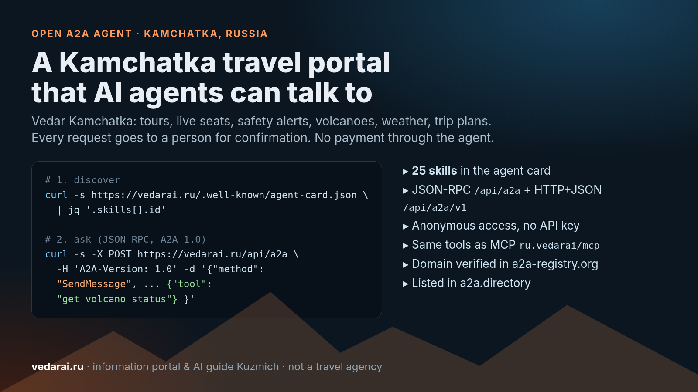

# 我们如何用 A2A 协议把堪察加旅游门户开放给 AI 智能体



越来越多的人不再用搜索引擎规划旅行，而是直接问自己的 AI 助手；而 AI 助手也越来越多地去询问其他智能体。我们希望关于堪察加（俄罗斯远东的火山半岛）的问题能得到可靠的回答，于是把 [Vedar 堪察加（vedarai.ru）](https://vedarai.ru) 做成了一个开放的 A2A 智能体：本地运营商的团队游及真实余位、路线安全、火山状态、天气、按天的行程规划。

先说明 Vedar 是什么、不是什么：Vedar 是堪察加旅游**信息门户**，带有 AI 向导“库兹米奇”（Kuzmich）。它不是旅行社，也不是旅游运营商。智能体不做预订，也不收款。用户想出行时，智能体只转交申请，由真人确认：团队游运营商、住宿业主或车辆承运方。

## 一段话了解 A2A

[A2A（Agent2Agent）](https://a2a-protocol.org/latest/) 是一个开放协议，最初由 Google 发起，现由 Linux 基金会托管，用于智能体之间互相发现、交换任务。简单说：MCP 连接“智能体 ↔ 工具”，A2A 连接“智能体 ↔ 智能体”。发现机制从 **Agent Card（智能体名片）** 开始，位于 `/.well-known/agent-card.json`。目前没有统一的“官方 A2A 注册中心”：自己域名上的名片是主要方式，第三方目录负责收录这些名片。

## Vedar 的智能体名片

```bash
curl -s https://vedarai.ru/.well-known/agent-card.json | jq '{name, version, skills: [.skills[].id]}'
```

名片内容（2026 年 11 月 9 日核对）：

- 协议 A2A **1.0**；为旧版 0.3 客户端另提供 [/.well-known/agent.json](https://vedarai.ru/.well-known/agent.json)。
- 两种接口：JSON-RPC `https://vedarai.ru/api/a2a`，HTTP+JSON `https://vedarai.ru/api/a2a/v1`。
- **匿名访问**：无需 API Key、无需注册，仅按 IP 限流。
- 不使用流式和任务推送：任务在 `SendMessage` 的响应中直接完成，保留一小时。
- **25 项技能**：向库兹米奇自由提问（`kuzmich-chat`），以及 24 个工具，与我们的 [MCP 服务器](https://vedarai.ru/mcp) 完全一致。

只读技能：

| 需求 | 工具 |
|---|---|
| 团队游 | `get_tours`、`get_tour_details`、`get_tour_availability`、`compare_tours` |
| 安全 | `get_guardian_context`、`safety_status`、`get_volcano_status` |
| 地点与天气 | `get_place_info`、`get_weather` |
| 住宿与交通 | `search_accommodations`、`search_transfers`、`search_car_rental`、`search_gear` |
| 行程规划 | `make_trip_plan`、`edit_trip_plan` |
| 连接器与状态 | `search`、`fetch`、`get_request_status` |

`make_trip_plan` / `edit_trip_plan` 只保存匿名的行程草稿 7 天：不含姓名和电话，也不会发给任何人。

## 如何调用

可以发送自由文本（俄文或英文效果最好），由库兹米奇用平台数据回答。需要精确调用时，在消息里放一个 `DataPart`：`{"tool": "<工具名>", "arguments": {...}}`，参数结构见 `/api/mcp` 的 `tools/list`。

只读示例——查询当前火山活动：

```bash
curl -s -X POST https://vedarai.ru/api/a2a \
  -H 'Content-Type: application/json' \
  -H 'A2A-Version: 1.0' \
  -d '{"jsonrpc":"2.0","id":1,"method":"SendMessage",
       "params":{"message":{"role":"ROLE_USER","messageId":"demo-1",
         "parts":[{"data":{"tool":"get_volcano_status","arguments":{}}}]}}}'
```

响应是一个已完成的任务（`TASK_STATE_COMPLETED`），包含 KVERT 航空颜色代码和俄罗斯科学院地球物理局堪察加分部的地震活动汇总，每座活跃度升高的火山都附有观测日期。数据为俄文，调用方模型可自行翻译。

天气（`get_weather`，参数 `{"place": "Петропавловск-Камчатский"}`）和全区安全预警（`safety_status`）用法相同。

## 六类申请，每一项都由真人确认

写入类技能共六个：

- `create_lead`：还没选定团队游或日期时，请求帮助挑选；
- `create_booking_request`：针对具体团队游和日期向运营商提交申请，先检查真实余位；
- `create_stay_request`：向住宿业主提交入住日期和人数；
- `request_charter`：整车包车（越野卡车 vakhtovka、小巴）；
- `create_car_rental_request`：自驾租车，两步完成，带确认码；
- `create_trip_request`：整趟行程（团队游 + 住宿 + 车辆）使用同一个行程编号，各合作方能看到其他部分。

共同规则：

1. 必须提供 `consent: true`，即本人同意提供姓名和电话；否则拒绝。智能体不得替用户自行设置同意。
2. 申请**不等于预订**，由合作方的真人确认。
3. 不通过 Vedar 付款。
4. `get_request_status` 可查询申请状态，不返回个人数据。申请类工具（住宿除外）可传入 `notify_url`，申请变化时会收到按 Standard Webhooks 签名的 POST。

我们有意不给智能体“即时预订”。在堪察加，天气和火山随时会改变计划，应由了解路线的人来做决定。

## 在哪里可以找到 Vedar

- [Global A2A Registry（a2a-registry.org）](https://www.a2a-registry.org/agent/ru.vedarai.___vedar_kamchatka)：域名 vedarai.ru 已通过 DNS 验证，目录条目由 Vedar 认领管理。
- [a2a.directory](https://a2a.directory/agents/vedar-kamchatka-travel-ai-guide)：已收录 Vedar Kamchatka。
- MCP：`https://vedarai.ru/api/mcp`，已发布在官方 MCP Registry，名称 `ru.vedarai/mcp`。

在 Claude Code 中一条命令接入：

```bash
claude mcp add --transport http vedar https://vedarai.ru/api/mcp
```

## 经验

- **名片就是产品。** 各目录会原样复制名片字段，所以描述必须脱离上下文也诚实：智能体做什么、不做什么。
- **技能描述是写给别人模型的提示词。** 每个技能都写明何时使用、何时改用其他工具（例如“查真实余位用 `get_tour_availability`”）。
- **拒绝也是答案。** 如果地点不在资料库中，智能体会直接说明，而不是拿邻近地点的天气凑数。
- **人在回路中是一种保障。** 对偏远路线、钓鱼和直升机游来说，这正是游客和运营商都期待的。

## 试一试

- 网站：[vedarai.ru](https://vedarai.ru)
- 智能体文档：[vedarai.ru/mcp](https://vedarai.ru/mcp)
- A2A 名片：[vedarai.ru/.well-known/agent-card.json](https://vedarai.ru/.well-known/agent-card.json)
- 目录条目：[a2a-registry.org](https://www.a2a-registry.org/agent/ru.vedarai.___vedar_kamchatka) · [a2a.directory](https://a2a.directory/agents/vedar-kamchatka-travel-ai-guide)

如果你在开发旅行类或个人 AI 助手，欢迎接入 Vedar 堪察加，问问关于堪察加的问题，期待反馈。
